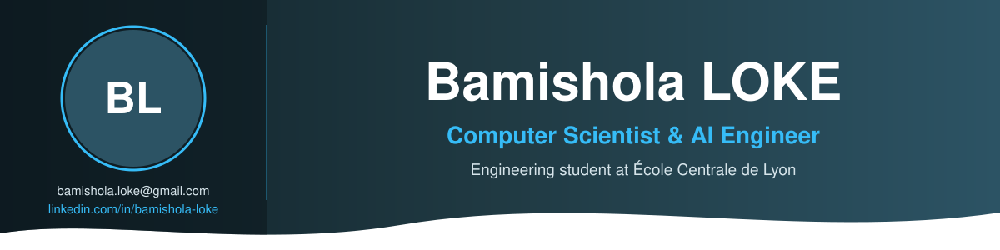

---

- Artificial Intelligence: LLMs, RAG, AI Agents, MCP, LangChain, LLM APIs (Claude, OpenAI), Vector Databases, Fine-tuning, LLM Evaluation, Hugging Face, PyTorch
- Machine Learning & Data: scikit-learn, pandas, NumPy, SQL, PostgreSQL, MongoDB
- Software Engineering: Python, TypeScript, JavaScript, Java, C, React, Next.js, FastAPI, Tailwind CSS, Automated Testing
- Cloud & DevOps: AWS, Docker, Linux, CI/CD (GitHub Actions), Vercel, Neon
- Tools: Git, GitHub, Claude Code, VS Code, Jupyter, Postman, MLflow, Weights & Biases

## 🐍 Mes contributions, version snake

<picture>
  <source media="(prefers-color-scheme: dark)" srcset="https://raw.githubusercontent.com/bamishola/bamishola/output/github-snake-dark.svg" />
  <source media="(prefers-color-scheme: light)" srcset="https://raw.githubusercontent.com/bamishola/bamishola/output/github-snake.svg" />
  
</picture>

